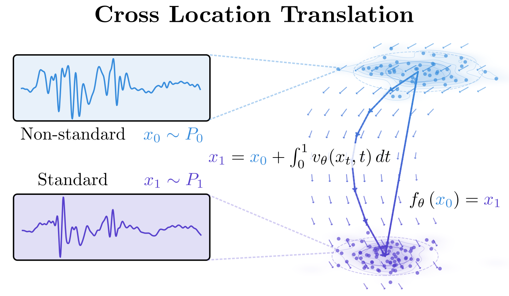
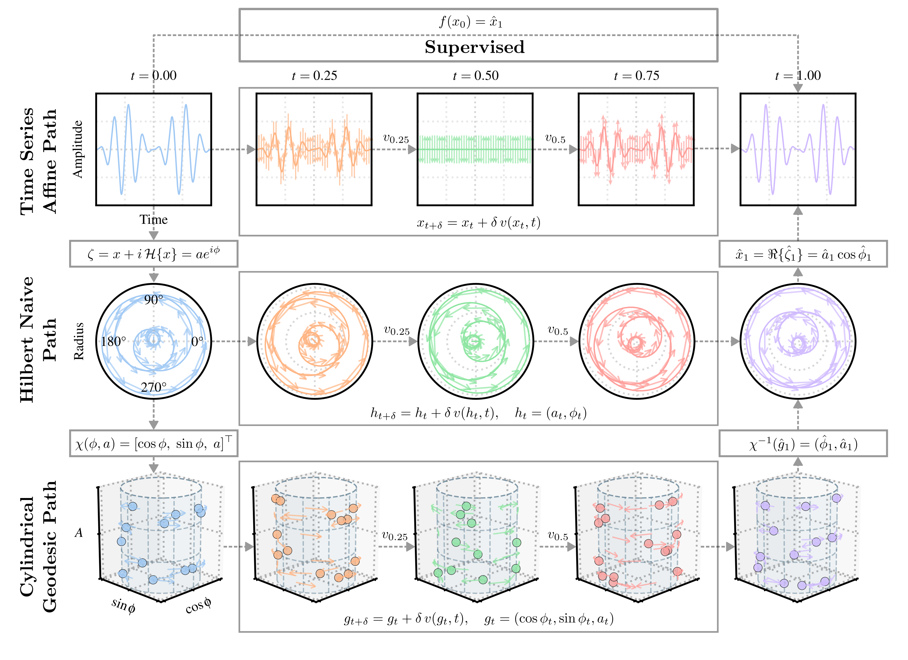

# Cylindrical Geodesic Flow Matching

Code for **Cylindrical Geodesic Flow Matching for Quasiperiodic Physiological Signal Transformation** ([arXiv:2610.08510](https://arxiv.org/abs/2610.08510)).



Paired translation between quasiperiodic physiological waveforms (i.e., recovering a target oscillatory signal from the source) is central to the interpretation of cardiovascular signals derived from wearables placed at different body locations. This source-to-target mapping in these problems carries inherent geometric structure: the phase wraps around the cycle and must be treated as a circular variable, the amplitude remains strictly positive, and the beat-to-beat alignment can drift unpredictably across cycles and subjects. While deep neural networks have been used for phase estimation and complex-valued signal modeling, prior work does not explicitly learn phase transport between paired signals. Consequently, neither endpoint-supervised regression nor the standard affine path used in flow matching accounts for this phase–amplitude structure.

We introduce *cylindrical geodesic flow matching* for paired cardiovascular waveform translation. We show that the standard affine path used in flow matching distorts intermediate amplitude and instantaneous frequency when interpolating between quasiperiodic signals; replacing it with a closed-form geodesic on the phase–amplitude cylinder eliminates these artifacts and converts each training pair into dense, geometry-consistent velocity supervision.

On zero-shot photoplethysmography and limited-support seismocardiography adaptation benchmarks, our method consistently outperforms interpolation baselines and matches or exceeds direct supervised prediction, reducing Hilbert Transform, L<sub>2</sub>, and Dynamic Time Warping distance by up to ~15% over the strongest competing baseline. These results suggest that bridge geometry is a critical inductive bias for flow matching on oscillatory signal translation.

<br clear="right">

<p align="center"></p>

## Setup

```bash
uv sync
```

Datasets are not included. Put them under `data/` and set `ACTIVE_CONFIG` in `settings.py` (`scg_beat` or `ppg_time_series`).

## Usage

```bash
PYTHONPATH=. python scripts/train.py    # train all methods/seeds in settings.py
PYTHONPATH=. python scripts/test.py     # zero-shot evaluation (L2, DTW, HT distance)
PYTHONPATH=. python scripts/fewshot.py  # SCG adaptation on a 512-beat support set per session
```

Results and checkpoints are written to `results/`.

## Citation

```bibtex
@article{kilic2026cylindrical,
  title   = {Cylindrical Geodesic Flow Matching for Quasiperiodic Physiological Signal Transformation},
  author  = {Kilic, Onur Selim and Nawar, Afra and Yaldiz, Cem Okan and Cho, Michael J. and Emirdagi, Ahmet Rasim and Tangolar, Demet and Aghazadeh, Amirali and Shah, Amit J. and Inan, Omer T.},
  journal = {arXiv preprint arXiv:2610.08510},
  year    = {2026}
}
```
